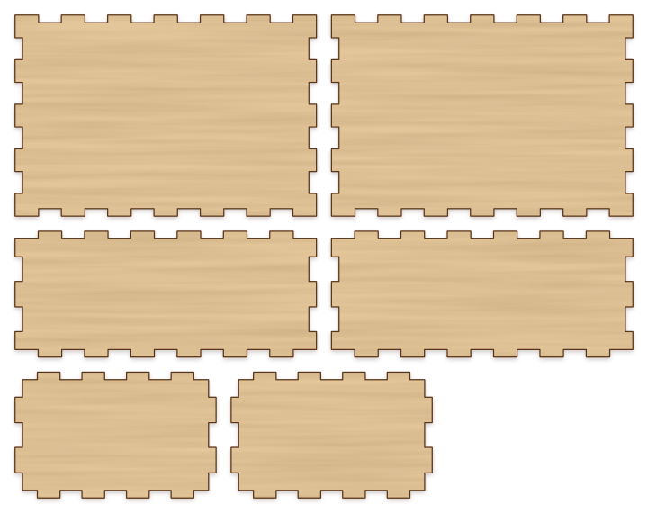
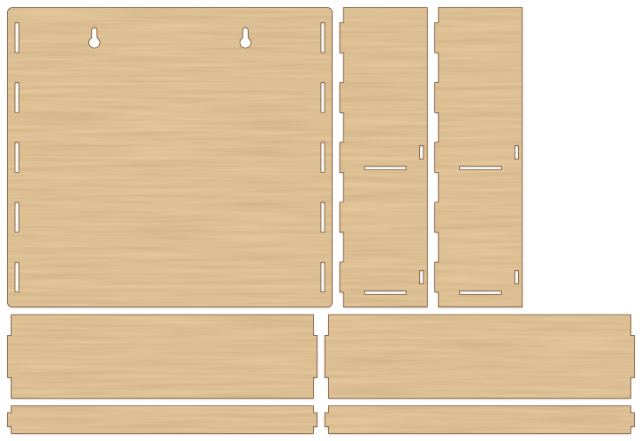
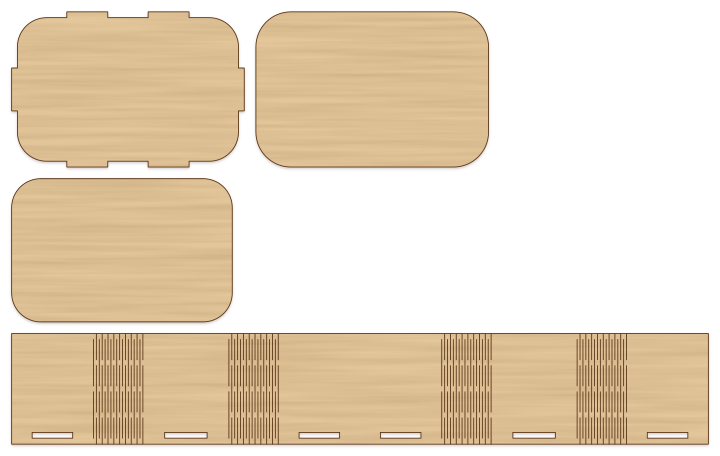
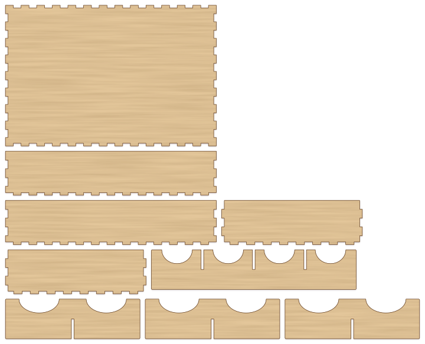
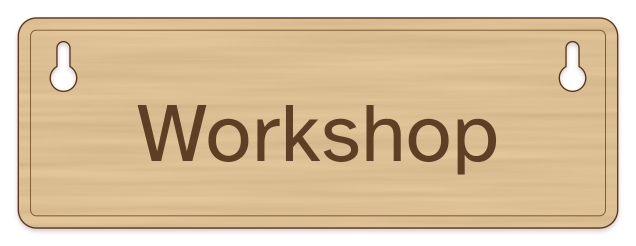
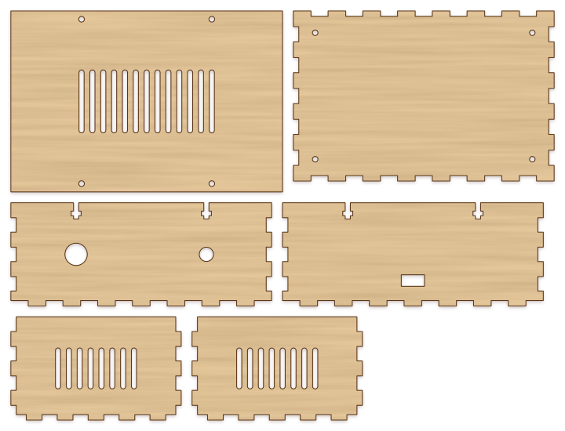
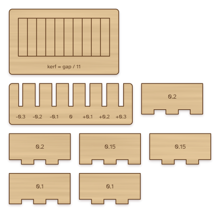

# Standard library

KerfScript comes with libraries for the parts most laser-cut designs need:
joints, hinges, dividers, hanging holes, boxes and test pieces. They are
built into every KerfScript renderer: the playground, the desktop app, the
command line and the JavaScript and WebAssembly libraries. A design that
uses them works everywhere without extra files.

```kerf
use <kerf/tabs>

part("shelf") tab_rect([200, 60], [false, true, false, true]);
```

`use` brings in a library's modules and functions. Its variables stay
inside it, and a module or function of your own with the same name is used
instead of the library's. Editors with the [language server](editors.md)
show each module's description when you hover over it.

| Library                            | Makes                                                          |
| ---------------------------------- | -------------------------------------------------------------- |
| [`kerf/box`](#boxes)               | Finger-jointed boxes and dividers that slide into them         |
| [`kerf/tabs`](#tabs-and-slots)     | Tabs on one panel and the slots in another that they go into   |
| [`kerf/stand`](#stands)            | A sign or photo standing in a base, upright or leaning back    |
| [`kerf/hinge`](#living-hinges)     | Living hinges that bend flat sheet, round boxes and bent walls |
| [`kerf/dividers`](#dividers)       | Dividers that slot into each other like an egg crate           |
| [`kerf/hanging`](#hanging)         | Keyholes, holes and loops for hanging things on a wall         |
| [`kerf/enclosure`](#enclosures)    | Boxes with a screwed-on lid, cutouts for ports and vents       |
| [`kerf/calibration`](#calibration) | Test pieces that measure the kerf and how your sheet fits      |
| [`kerf/gears`](#gears-and-cams)    | Gears, racks, cams, Geneva drives, ratchets and pawls          |
| [`kerf/linkage`](#linkages)        | Where linkage joints are at a crank angle                      |
| [`kerf/cones`](#cones)             | Cones and cut-off cones cut flat, to roll up                   |
| [`kerf/lock`](#lock)               | A lock with a key, three layers deep                           |
| [`kerf/rings`](#rings)             | Round things of stacked rings on a crossed core                |
| [`kerf/joints`](#joints)           | Two profiles halved into each other: crosses, fonts, domes     |
| [`kerf/fit`](#fit-and-align)       | Drawings scaled to a size and placed by a point of their box   |
| [`kerf/shapes`](#shapes)           | Hearts, teardrops, clouds, shields, banners, tags and more     |
| [`kerf/sizes`](#sizes)             | Paper, card and photo sizes                                    |
| [`kerf/symbols`](#symbols)         | 867 pictograms by name                                         |
| [`kerf/geo`](#maps)                | The world's land, for maps and globes                          |

Sizes are in millimetres. Joints use `$thickness`, the sheet thickness, so
set it to what you measure. Each section has an example in the gallery that
you can open in the playground.

### Before you draw it yourself

| To                                                 | Use                                                     |
| -------------------------------------------------- | ------------------------------------------------------- |
| Draw a heart, a teardrop, a cloud, a banner or tag | [`kerf/shapes`](#shapes)                                |
| Draw a pictogram: a paw, a tree, a star, a house   | `symbol("paw", size)` from [`kerf/symbols`](#symbols)   |
| Scale a drawing to a box, or place it by a corner  | `fit()` and `align()` from [`kerf/fit`](#fit-and-align) |
| Close small gaps between shapes                    | `close(r)`, in place of `offset(delta = -r) offset(r)`  |
| Fit text to a width or a height                    | `text(fit = [w, h])`, and `text_size()` to measure it   |
| Stand a sign or a photo up                         | `stand()` from [`kerf/stand`](#stands)                  |

## Boxes

`use <kerf/box>`



Finger-jointed boxes. Example: [box.kerf](../examples/box.kerf).

### `box(size, lid = false, finger, name = "")`

The panels of a box as parts `bottom`, `front`, `back`, `left`, `right` and,
with a lid, `lid`, placed for the assembled view. Shapes given to `box()`
go on the front, drawn from its bottom left corner as seen from outside.
Wrap it in `place()` to set it anywhere:

```kerf
use <kerf/box>

place(at = [0, 0, 40]) box([120, 80, 60], name = "crate")
  engrave() translate([60, 30]) text("TEA", size = 14, halign = "center");
```

| Parameter | Default                  | Meaning                                                |
| --------- | ------------------------ | ------------------------------------------------------ |
| `size`    |                          | Outside `[width, depth, height]`, lid included         |
| `lid`     | `false`                  | Add a lid, finger-jointed to the walls like the bottom |
| `finger`  | `max(3 * $thickness, 6)` | Finger width                                           |
| `name`    | `""`                     | Goes before each panel's name, as `crate front`        |

### `divider(size, finger)`

A divider `[width, height]` with finger tabs on both sides, to slide into
rows of `finger_holes()` cut in two walls.

## Tabs and slots

`use <kerf/tabs>`



Tab and slot joints, for one panel standing on or through another. The
tabs are as deep as `$thickness`, so they finish flush with the far side.
Example: [spice-shelf.kerf](../examples/spice-shelf.kerf), a wall shelf
held together by tabs alone.

```kerf
use <kerf/tabs>

// A side with a slot for the shelf 40 mm up, and the shelf
part("side") difference() {
  rect([60, 120]);
  translate([0, 40]) slots(60);
}
part("shelf") tab_rect([150, 60], [false, true, false, true]);
```

### `tabs(length, count, width, depth)`

Tabs along x from 0 to `length`, hanging below y = 0: join them to the
bottom edge of a panel.

| Parameter | Default                         | Meaning                    |
| --------- | ------------------------------- | -------------------------- |
| `length`  |                                 | Length of the edge         |
| `count`   | one for every 50 mm, at least 1 | Number of tabs             |
| `width`   | half the space between tabs     | Width of each tab          |
| `depth`   | `$thickness`                    | How far the tabs stand out |

### `slots(length, count, width, clearance = 0.1)`

The slots that `tabs()` with the same `length`, `count` and `width` go
through, centred on y = 0. `clearance` is added to their width and to
`$thickness`; [cut a slot gauge](#calibration) to find the right
value for your sheet.

### `tab_rect(size, edges = true, count, width)`

A rectangle `[width, height]` with tabs outside it on some edges. `edges`
is `true` or `false` for all four, or `[bottom, right, top, left]`.

### `tab_positions(length, count)`

The centres of the tabs along an edge, for placing anything else that
lines up with them.

## Stands

`use <kerf/stand>`

A panel (a sign, a photo frame, a calendar) standing in a base, its tabs
through slots in the base, upright or leaning back. `stand()` makes both
parts and puts them together; the tabs and slots always match, at any
lean and `$thickness`.

```kerf
use <kerf/stand>

stand(160, depth = 45, lean = 10) {
  rect([160, 90], r = 6);
  engrave() translate([80, 45]) text("OPEN", fit = [120, 40], halign = "center", valign = "cap");
}
```

### `stand(width, depth = 40, count, tab, lean = 0, margin = 10, back, r = 3, clearance = 0.1, name = "Sign")`

The children draw the panel, its bottom edge on y = 0 from x = 0 to
`width`; `stand()` adds the tabs. The base is `depth` deep, `margin` wider
than the panel on each side, with corners rounded to `r`. The panel leans
back by `lean` degrees (up to 45), its back face meeting the base `back`
from the front (half way by default). The parts are `name` and
`"name stand"`.

| Parameter   | Default                         | Meaning                              |
| ----------- | ------------------------------- | ------------------------------------ |
| `count`     | one for every 50 mm, at least 1 | Number of tabs                       |
| `tab`       | half the space between tabs     | Width of each tab                    |
| `clearance` | `0.1`                           | Added to each slot's width and depth |

### `stand_tabs(width, count, tab, lean = 0)`

The tabs for the bottom edge of a panel, x from 0 to `width`, hanging below
y = 0 far enough to go through a base `$thickness` thick at that lean.

### `stand_slots(width, count, tab, lean = 0, clearance = 0.1)`

The slots for `stand_tabs()` with the same `width`, `count`, `tab` and
`lean`, for a base of your own: x from 0 to `width`, for a panel whose back
face meets the top of the base on y = 0, leaning back towards +y.

## Living hinges

`use <kerf/hinge>`



Living hinges: rows of cuts that let plywood bend. They work best in 3 mm
plywood or thinner. Example: [flex-box.kerf](../examples/flex-box.kerf),
and [hinge-card.kerf](../examples/hinge-card.kerf) for a simple fold.

```kerf
use <kerf/hinge>

// A strip that bends 90° around a 10 mm radius in the middle
flex_rect([200, 60], [100], width = bend_length(10));
```

### `bend_length(r, angle = 90)`

How long a living hinge must be to bend `angle` degrees around an inside
radius `r`: the length of the arc through the middle of the sheet.

### `flex_rect(size, bends, width, spacing = 1.5, bridge = 3, r = 0)`

A rectangle with a living hinge across its full height at each x in
`bends`.

| Parameter | Default                       | Meaning                                                     |
| --------- | ----------------------------- | ----------------------------------------------------------- |
| `size`    |                               | `[width, height]`                                           |
| `bends`   |                               | List of x positions, the middle of each hinge               |
| `width`   | `bend_length(3 * $thickness)` | Width of each hinge                                         |
| `spacing` | `1.5`                         | Distance between the rows of cuts; closer bends more easily |
| `bridge`  | `3`                           | Uncut length between cuts                                   |
| `r`       | `0`                           | Corner radius of the rectangle                              |

### `flex_box(size, r = 15, lid = true, clearance = 0.1, spacing = 1.5, bridge = 3)`

A box with round corners whose four sides are one strip, part `side`,
bent at the corners. The tabs of part `bottom` go through slots along the
strip. Part `lid` rests on top, and part `lid insert`, glued under it,
keeps it in place. `size` is the outside `[width, depth, height]`, lid
included, and `r` the outside corner radius, more than two thicknesses.
The assembled view shows the strip bent round the bottom.

### `flex_panel(size, r, sw, sd)`

The bottom of `flex_box()`: a rounded rectangle with tabs on its straight
edges, `sw` long on the front and back and `sd` on the sides.

### `narrow_hinge(size, spacing = 1.5, bridge = 1.5)`

A hinge for a narrow strap or band, as lines across `[w, h]`: cuts from
alternate edges, each stopping `bridge` short of the far edge, so the
strip zigzags and bends evenly however narrow it is. Use it where
`living_hinge()` would leave only a cut or two across.

### `flex_strip(path, width, name = "strip", tabs = true, straight = 10, r, spacing = 1.5, bridge = 3, narrow = false)`

A strip that follows a profile: `path` is a list of `[x, y]` points along
its middle in a side plate's plane, as `path_points()` or a list
comprehension gives them. The strip has a living hinge wherever the path
curves and tabs along both edges wherever it runs straight. It is one
part, placed in the plate's coordinates with its edge at z = 0 and its
width running down to `-width`, and bent in the assembled view.

```kerf
use <kerf/hinge>

W = 80;
path = [for (a = [180:5:360]) [40, 40] + 40 * [cos(a), sin(a)]];
module plate() offset(delta = 12) polygon(concat(path, [[80, 70], [0, 70]]));
part("end A", rotate = [90, 0, 0], slots = ["tray"]) plate();
part("end B", at = [0, W + $thickness, 0], rotate = [90, 0, 0], slots = ["tray"]) plate();
place(rotate = [90, 0, 0]) flex_strip(path, W, name = "tray");
```

Wrap it in `place()` with the plate's placement, put the other plate
`width` away, and give both plates `slots`: they cut the slots for the
tabs where the strip passes through them. Segments of the path shorter
than `straight` are taken as curve; a sharp corner bends round radius
`r`, two thicknesses by default, and the strip follows the rounded
corner: it is as long as the path with its corners rounded, and ends
where the path ends. A path with no curve or corner makes a straight
strip. Sample a curve with segments shorter than `straight`: a curve
sampled more coarsely is cut as straight runs with a sharp bend at each
point. `narrow` uses `narrow_hinge()`.

### `wall(outline, depth, name = "wall", join, max_length = 400, rim, seam = 0.3, tabs = true, straight = 10, r, spacing = 1.5, bridge = 3, narrow = false, at = [0, 0, 0], rotate = [90, 0, 0])`

A wall round a closed outline, as for a lantern, a light box or a round
case: a front plate, a back plate `depth` behind it, and a strip between
them that follows the outline, made by `flex_strip()`. The strip bends on
living hinges where the outline curves and has tabs where it runs
straight, and both plates cut the slots for them.

```kerf
use <kerf/hinge>

// A lantern: two straights and two round ends, the seam at the bottom
outline = concat(
  [for (a = [-90:5:90]) [100, 40] + 40 * [cos(a), sin(a)]],
  [for (a = [90:5:270]) [40, 40] + 40 * [cos(a), sin(a)]]
);
wall(outline, 50, name = "lantern", join = [70, 0], max_length = 200) {
  difference() {
    offset(delta = 5) polygon(outline);
    translate([70, 40]) circle(d = 40);
  }
}
```

- The strip's ends meet at the point of the outline nearest `join`: put
  the seam on a straight, or where a cap or a foot will hide it. Without
  `join` they meet in the middle of the longest side.
- Sharp corners of the outline are rounded as the strip bends round
  them, radius `r` inside: the strip follows `strip_loop(outline)`.
- A strip longer than `max_length` is cut into pieces no longer, so each
  fits the bed, split on a straight where one is near. The pieces meet
  `seam` apart, so that bent on their hinges they don't press on each
  other.
- The first child is the front plate, drawn as the outline is, with the
  windows or art you cut in it; the second is the back plate. Without
  them, each plate is the outline grown by `rim`, half a thickness and
  3 mm.
- The parts are `"<name> front"`, `"<name> back"` and `"<name> strip"`, or
  `"<name> strip 1"`, `"<name> strip 2"` and so on for a strip in pieces.
  `wall_pieces(outline, max_length, join, straight, r)` says how many
  pieces there will be.
- It stands upright with the outline seen from the front, the back plate
  behind it; `at` and `rotate` place it.

Sample the outline's curves with segments shorter than `straight`, as for
`flex_strip()`.

### `wall_path(outline, join)`

A closed outline as the path round it from the point of it nearest
`join` all the way round to it again; without `join`, from the middle of
its longest side. `wall()` follows `wall_path(strip_loop(outline), join)`.

### `path_part(path, s0, s1)`

The part of a path from `s0` to `s1` along it, its ends where those fall.

### `wall_strip_names(name, pieces)`

The names of the strip's parts for a wall named `name` in that many
pieces, as `slots` lists them: `wall_strip_names("lantern", 2)` is
`["lantern strip 1", "lantern strip 2"]`.

### `wall_splits(L, n, max_length, mids, halves)`

Where `wall()` splits a strip `L` long into `n` pieces no longer than
`max_length`: near even spacing, at a point of `mids` (the middles of the
straight runs) where one is near, else at one of `halves` (the middles of
the path's segments, where its bends end).

### `strip_path(path, straight = 10, r)`

The path a strip bent along `path` follows: each sharp corner, where
two segments at least `straight` long meet, rounded to an arc whose
inside radius is `r` (two thicknesses by default), the middle of the
sheet tangent to both segments. A corner too tight for the segments
beside it rounds to the radius that fits half of each. `flex_strip()` is
as long as this path.

### `strip_loop(outline, straight = 10, r)`

A closed outline with its sharp corners rounded as `strip_path()` rounds
a path's, each corner judged by its whole sides.

### `strip_corner(a, p, b, straight = 10, r)`

The points of the rounded corner at `p`, coming from `a` and going on to
`b`, as `strip_path()` and `strip_loop()` round it: the arc, or `[p]`
where the corner is not sharp.

### `strip_bends(path, straight = 10, r)`

The bends `flex_strip()` makes, as `[s0, s1, angle]` along the path with
its corners rounded by `strip_path()`:
where each curve starts and ends and how far it turns, left positive.
A curve whose radius changes, such as a tight fillet running into a wide
arc, gives several bends end to end, one for each stretch of much the
same radius, so the bent strip follows the path. Give them to
`part(bend = ...)` for a strip of your own.

### `strip_join(list)`

Joins bends that touch or overlap where they turn the same way at much
the same rate, within a quarter of each other; `strip_bends()` uses it.
Two that overlap but turn differently meet halfway through the overlap.

### `strip_merge(list)`

Joins bends that touch into one, whatever their radius: the stretches
`flex_strip()` cuts its hinges over.

## Dividers

`use <kerf/dividers>`



Dividers with slots halfway up, so a divider running one way and one
running the other slide into each other. Example:
[drawer-organizer.kerf](../examples/drawer-organizer.kerf), a box from
`kerf/box` with a grid of dividers inside.

```kerf
use <kerf/dividers>

// Four compartments across, two front to back, in a 200 × 120 space
grid_dividers([200, 120, 40], cols = 4, rows = 2);
```

### `grid_dividers(size, cols = 2, rows = 2, clearance = 0.15, gap = 0.5, scoops = false, at = [0, 0, 0])`

The dividers for a space `[width, depth, height]`, such as the inside of
a box, making `cols` compartments across and `rows` front to back. Parts
`long divider` run left to right and `cross divider` front to back.

| Parameter   | Default     | Meaning                                                               |
| ----------- | ----------- | --------------------------------------------------------------------- |
| `size`      |             | Inside `[width, depth, height]`; the dividers are this tall           |
| `cols`      | `2`         | Compartments across                                                   |
| `rows`      | `2`         | Compartments front to back                                            |
| `clearance` | `0.15`      | Added to the slot width                                               |
| `gap`       | `0.5`       | How far the dividers stop short of the walls                          |
| `scoops`    | `false`     | Dip the top edge over each compartment, to reach in                   |
| `at`        | `[0, 0, 0]` | Where the space's front left bottom corner is, for the assembled view |

### `slotted_divider(length, height, at = [], from = "top", clearance = 0.15, scoops = 0)`

One divider, with a slot half its height at each x in `at`: from the top,
or from the bottom with `from = "bottom"`. Two dividers that cross take
one of each. `scoops` is the number of finger dips in the top edge.

## Hanging

`use <kerf/hanging>`



Ways to hang a panel. Each module cuts its holes out of the shapes it is
given; given nothing, it makes the holes themselves, for a
`difference()` of your own. Example:
[wall-sign.kerf](../examples/wall-sign.kerf), with all three ways.

```kerf
use <kerf/hanging>

// Two keyholes 120 mm apart, 12 mm below the top edge
keyholes(120, at = [80, 48]) rect([160, 60], r = 5);
```

### `keyhole(at = [0, 0], head = 9, shank = 4.5, drop = 10)`

A keyhole for a screw: the head goes through the round hole, then the
panel drops `drop` mm so the screw rests at `at`, at the top of the slot.
`head` and `shank` are the widths of the hole and the slot: measure the
screw and add a little. `drop` must be at least `(head + shank) / 2`.

### `keyholes(spacing, at = [0, 0], head = 9, shank = 4.5, drop = 10)`

Two keyholes `spacing` apart, centred on `at`, for a panel that hangs
level.

### `hanging_hole(at = [0, 0], d = 5, spacing = 0)`

A round hole for a nail, a hook or a cord, or two `spacing` apart.

### `hanging_loop(at = [0, 0], d = 4, wall = 3)`

A ring `wall` wide around a hole of diameter `d`, joined to the shapes it
is given. Put it over the edge of an ornament or a tag: the hole stays open
where the ring overlaps the shape. Overlap the ring with the shape, or the
loop comes out as a separate piece.

## Enclosures

`use <kerf/enclosure>`



A box whose lid comes off again, for electronics. The walls and the bottom
are finger jointed. The lid overhangs the walls a little and is held by
screws that go down into the walls' top edges, each into a nut that sits
in a T-slot. Example: [project-enclosure.kerf](../examples/project-enclosure.kerf).

```kerf
use <kerf/enclosure>

enclosure([150, 100, 60], cutouts = [
  ["front", [36, 28], 8],              // a round hole for a jack
  ["back", [72, 15], [13, 6.5]],      // a rectangle for a USB port
  ["lid", [75, 50], [70, 30], "vents"],
]);
```

### `enclosure(size, screw = 3, screw_length = 12, nut, lip, cutouts = [], finger)`

Parts `bottom`, `lid`, `front`, `back`, `left` and `right`, placed for the
assembled view. Two screws go into the front wall and two into the back,
and one more each for every 80 mm of width.

| Parameter      | Default                      | Meaning                                        |
| -------------- | ---------------------------- | ---------------------------------------------- |
| `size`         |                              | Outside `[width, depth, height]`, lid included |
| `screw`        | `3`                          | Screw diameter: 3 for M3                       |
| `screw_length` | `12`                         | Screw length under the head                    |
| `nut`          | `[screw * 1.9, screw * 0.9]` | `[width, height]` of the slot for the nut      |
| `lip`          | `screw`                      | How far the lid overhangs the walls            |
| `cutouts`      | `[]`                         | Holes in the panels, see below                 |
| `finger`       | `max(3 * $thickness, 6)`     | Finger width                                   |

The walls stand `lip` in from the edge of the lid, so a design for an
`[150, 100, 60]` enclosure with M3 screws has walls 144 × 94 mm.

### `enclosure_cutouts(side, cutouts)`

The holes in `cutouts` for one panel; `enclosure()` cuts them. Each is
`[side, [x, y], size]`:

- `side` is `"front"`, `"back"`, `"left"`, `"right"`, `"lid"` or `"bottom"`.
- `[x, y]` is the middle of the hole on the panel as it is drawn, from its
  bottom left corner. On the front and back x runs left to right as seen
  from the front; on the sides it runs from front to back. y runs up from
  the bottom of the wall.
- A number `size` is a round hole of that diameter, `[width, height]` a
  rectangle. Add `"vents"` after a rectangle to fill it with vents.

### `vents(size, slot = 3, pitch = 6)`

Ventilation slots across `[width, height]`, centred on the origin: upright
slots `slot` wide with round ends, `pitch` apart.

## Calibration

`use <kerf/calibration>`



Test pieces to cut once for every new material, before a design that has
to fit. Their labels are text, so they need a font, as
[`text()`](../LANGUAGE.md#shapes) does; `labels = false` leaves them off.
Example: [calibration-set.kerf](../examples/calibration-set.kerf); the
[Kerf](kerf.md) guide explains what to do with the results.

```kerf
use <kerf/calibration>

$thickness = 3;
part("kerf gauge") kerf_gauge();
part("slot gauge") slot_gauge();
joint_test([0.1, 0.15, 0.2]);
```

### `kerf_gauge(strips = 10, size = [60, 25], labels = true)`

A frame with `strips` strips inside, all separated by single cuts.
Single cut lines are not moved by kerf compensation, so each takes away
one kerf. Push the strips to one side and measure the gap they leave: the
kerf is the gap divided by `strips + 1`. `size` is the window the strips
fill.

### `slot_gauge(steps = 7, step = 0.1, depth = 15, labels = true)`

A comb of `steps` slots, from narrower than `$thickness` to wider, `step`
apart, each labelled with the difference. Try a scrap of the same sheet in
each: the one that fits as you want is the clearance for `slots()` and
`grid_dividers()`.

### `joint_test(kerfs = [0.1, 0.15, 0.2], size = [40, 20], finger, labels = true)`

A pair of finger-jointed pieces for each kerf in `kerfs`, parts
`joint <kerf> out` and `joint <kerf> in`, each cut with that kerf
compensation. The pair that holds together without glue or forcing has
the kerf to set for this sheet.

## Gears and cams

`use <kerf/gears>`

Gears, racks, the lantern gears of old mills, and the cams and tappets
that make a model move. Gears go by their module `mod`: the pitch
diameter is `mod * teeth`, and two gears mesh when they have the same
module and their centres are `gear_distance()` apart.

```kerf
use <kerf/gears>

part("big") spur_gear(36, 2, bore = 6, spokes = 5);
part("small", at = [gear_distance(36, 12, 2), 0, 0], rotate = [0, 0, gear_phase(12)])
  spur_gear(12, 2, bore = 6);
```

### `spur_gear(teeth, mod = 2, bore = 5, pressure = 20, backlash = 0.1, spokes = 0, square = false)`

A gear with involute teeth centred on the origin, a tooth along +x, and a
hole for its axle: round, or `square` to turn with a square axle.
`spokes` from 3 to 6 cuts windows between spokes. `backlash` thins each
tooth so meshed gears don't bind.

### `gear_points(teeth, mod = 2, pressure = 20, backlash = 0.1, steps = 6)`

The gear's outline as a list of points, for gears of your own shape.

### `gear_window(r0, r1, span, w)`

One rounded window between two spokes, from radius `r0` to `r1`.

### `gear_radius(teeth, mod = 2)`, `gear_distance(teeth_a, teeth_b, mod = 2)`

The pitch radius, and the distance between the centres of two gears in
mesh.

### `gear_turn(driver, driven, angle)`

How far a gear with `driven` teeth turns when one with `driver` teeth in
mesh with it turns `angle` degrees: the other way round.

### `gear_phase(teeth)`

The turn that lines a gear's teeth up with the gear beside it along x.

### `train_for(ratio, stages = 2, pinion = [10, 20], wheel = [20, 80])`

Tooth counts for a train of `stages` gear pairs (1 to 3) whose ratio, the
turns in for one turn out, comes nearest `ratio`. Each pair has a pinion
of `pinion` teeth and a wheel of `wheel` teeth on the next axle. It
returns `{stages = [[driver, driven], ...], ratio, error}`, `error` being
how far off it is, as a fraction; of equally near trains it picks the one
with fewest teeth. A ratio under 1 speeds up, so the wheels drive. It is
built in, so it works without `use <kerf/gears>`.

```kerf
use <kerf/gears>

// A year for the Earth in an orrery: [[10, 73], [10, 76], [12, 79]], 0.002% off
t = train_for(365.25, 3);
s = t.stages[0];
part("pinion") spur_gear(s[0], 1.5);
part("wheel", at = [gear_distance(s[0], s[1], 1.5), 0, 0], rotate = [0, 0, gear_phase(s[1])])
  spur_gear(s[1], 1.5);
```

### `rack(teeth, mod = 2, height, pressure = 20, backlash = 0.1)`

A straight rack along +x, its pitch line at y = 0. A `spur_gear()` of the
same module meshes with it from `gear_radius()` above.

### `lantern_disc(staves, r, d = 6, bore = 6, rim)`, `peg_wheel(pegs, r, d = 6, bore = 6, rim)`

A lantern gear is two discs with dowel staves between them; `lantern_disc()`
is one disc, with holes for `staves` staves of diameter `d` on radius `r`.
A `peg_wheel()` has dowel pegs standing out of its face, which drive the
staves of a lantern gear at right angles. Match the pitch of the pegs and
the staves.

### `peg_radius(n, pitch)`

The radius for `n` pegs or staves `pitch` apart.

### `eccentric(r, offset, bore = 6, square = false)`, `snail_cam(r0, r1, bore = 6, steps = 72, square = false)`, `tappets(n, r, w = 10, hub = 14, bore = 6, square = false)`

Cams: an `eccentric()` pushes a follower up and down by twice `offset`; a
`snail_cam()` lifts it slowly from `r0` to `r1` over a turn and drops it at
once, as a trip hammer works; `tappets()` lift a lever `n` times a turn.

### `cam(lift, base_r, follower = "knife", roller_d = 0, bore = 6, steps = 180, square = false)`

A cam whose profile comes from a lift curve: `lift` is a function of the
angle (0 to 360) giving how far the follower rises above the base circle
of radius `base_r`. The follower rides on the cam's top (+y) and moves
straight up and down; turned anticlockwise by `a` degrees (`rotate = [0,
0, a]`) the cam lifts it `lift(a)`. A `"knife"` follower rides the curve
itself; a `"roller"` of diameter `roller_d` rolls on a profile inside it.

```kerf
use <kerf/gears>

$fn = 48;
turn = 0; // the cam's angle
// A bird that pecks twice, then rests
peck = function(a) cam_rise(a, 0, 40, 8) - cam_rise(a, 40, 80, 8) + cam_rise(a, 100, 140, 8) - cam_rise(a, 140, 180, 8);
part("cam", rotate = [0, 0, turn]) cam(peck, 25, "roller", 10);
part("roller", at = [0, cam_follower(peck, 25, turn, 10), 0]) difference() { circle(d = 10); circle(d = 3); }
```

### `cam_rise(a, a0, a1, height)`

A smooth (cycloidal) rise of `height` between angles `a0` and `a1`: 0
before, `height` after. Add and take away rises to make dwells, rises and
falls.

### `cam_follower(lift, base_r, angle, roller_d = 0)`, `cam_pressure(lift, base_r, roller_d = 0)`

How high the follower's tip, or its roller's centre, stands above the
cam's axle at `angle`, to place it from the same curve. `cam_pressure()` is
the steepest pressure angle over a turn: keep it under about 30 degrees,
with a bigger base circle or a longer rise, or the follower jams.

### `cam_pitch(lift, base_r, roller_d = 0, steps = 180)`

The curve the follower's tip or roller centre follows, in the cam's turn.

### `geneva_wheel(slots, distance, pin_d = 6, bore = 6, clearance = 0.2)`, `geneva_lock(...)`, `geneva_crank(...)`

A Geneva drive: a driver turning all the time steps a wheel on one slot
each turn and locks it in between, for counters, calendars and carousels
that stop to show each scene. The driver's axle is at the origin and the
wheel's `distance` along +x. The wheel and the locking disc lie side by
side in one plane; the crank above the disc carries a dowel pin of `pin_d`
that runs in the slots. With many slots the wheel comes close to the
driver's axle, and `geneva_lock()` says how small the bore must be.

```kerf
use <kerf/gears>

$fn = 48;
a = 0; // the driver's turn
part("wheel", at = [60, 0, 0], rotate = [0, 0, geneva_turn(6, 60, a)]) geneva_wheel(6, 60, 6);
part("lock", at = [0, 0, 0], rotate = [0, 0, a]) geneva_lock(6, 60, 6);
part("crank", at = [0, 0, $thickness], rotate = [0, 0, a]) geneva_crank(6, 60, 6);
```

### `geneva_turn(slots, distance, angle)`

How far the wheel has turned (clockwise) when the driver has turned
`angle` anticlockwise from its pin pointing at the wheel: `-360 / slots`
for each whole turn. With `geneva_pin_radius()`, `geneva_wheel_radius()`
and `geneva_lock_radius()` for the sizes.

### `ratchet(teeth, r, depth, bore = 6, square = false)`, `pawl(teeth, r, depth, length, width = 8, bore = 3, at = 90, clearance = 0.2)`

A ratchet wheel that turns anticlockwise freely, and a pawl that stops it
turning back: for a crank that winds one way, a counter or a typewriter
carriage. The pawl is drawn where it works round the wheel's centre, its
tip on the tooth face nearest `at` degrees, so give it the wheel's
placement. It turns on a pin at `pawl_pivot()`, and gravity, a rubber band
or a spring wire keeps it down on the teeth.

```kerf
use <kerf/gears>

$fn = 32;
part("wheel", at = [0, 0, 0]) ratchet(12, 30, 5);
part("pawl", at = [0, 0, 0]) pawl(12, 30, 5);
```

### `pawl_pivot(teeth, r, depth, length, width = 8, at = 90, clearance = 0.2)`, `pawl_points(...)`, `pawl_min_length(teeth, r, depth, width = 8)`, `pawl_face(teeth, at = 90)`, `pawl_lean(teeth, r, depth)`

Where the pawl's pivot pin goes round the wheel's centre, its outline, the
shortest it can be at a given width, the angle of the tooth face it rests
on, and how far it leans out from the wheel's edge to clear the teeth as
they pass. Left at 0, `length` is 0.8 × `r`, or the shortest that clears
the teeth on a small wheel; a `length` given shorter than that is an
error.

## Linkages

`use <kerf/linkage>`

Where the joints of a linkage are at a crank angle, so moving parts are
placed from the same numbers as the links' lengths: steam engine pistons,
typebars, walking legs, waving arms. Each takes the linkage drawn flat.

```kerf
use <kerf/linkage>

$fn = 32;
angle = 60; // the crank's turn
j = four_bar(80, 20, 70, 50, angle);
part("crank", at = [0, 0, 3], rotate = [0, 0, angle]) hull() { circle(d = 10); translate([20, 0]) circle(d = 10); }
part("rocker", at = [80, 0, 3], rotate = [0, 0, link_angle([80, 0], j[1])])
  hull() { circle(d = 10); translate([50, 0]) circle(d = 10); }
```

### `circle_meet(a, ra, b, rb, side = 1)`

Where a circle of radius `ra` round `a` meets one of radius `rb` round `b`:
the point left of the line from `a` to `b`, or right of it with `side =
-1`. `undef` when they don't meet. Two links of those lengths from those
pivots join there.

### `slider_crank(r, l, angle, offset = 0)`, `slider_stroke(r, l, offset = 0)`

A crank of radius `r` round the origin drives a slider along `y = offset`
through a rod `l` long: `[crank pin, slider pin]` at the crank's `angle`,
or `undef` where the rod can't reach. `slider_stroke()` is how far the
slider travels.

### `four_bar(ground, crank, coupler, rocker, angle, side = 1)`, `four_bar_turns(ground, crank, coupler, rocker)`

A four-bar linkage with the crank's pivot at the origin and the rocker's at
`[ground, 0]`: `[crank end, rocker end]` at the crank's `angle`, or
`undef` where the links can't close. `four_bar_turns()` is true when the
crank turns all the way round (Grashof's rule).

### `link_angle(a, b)`

The angle of the line from `a` to `b`, to turn a link along it.

## Cones

`use <kerf/cones>`

Cones and cut-off cones cut flat from paper, card, veneer or thin plastic,
to roll up: gramophone horns, lampshades, funnels.

```kerf
use <kerf/cones>

$fn = 64;
part("shade") cone_flat(60, 25, 70, tab = 8);
```

### `cone_flat(r1, r2, h, tab = 0, steps = 0)`

The flat pattern of a cone of radius `r1` at one end, `r2` at the other,
`h` high: a ring sector with its apex at the origin, opening anticlockwise
from +x. `tab` adds a glue tab along the far edge with its fold scored.
Equal radii make a cylinder: a rectangle `2 * PI * r1` wide.

### `cone_pattern(r1, r2, h)`

The sector's `[outer radius, inner radius, angle, slant length]`.

## Lock

`use <kerf/lock>`

A lock with a key, for boxes, diaries and money boxes. A flat key turns an
eccentric cam that slides a bolt; half a turn throws its nose out past the
lock's top edge into a notch in whatever it locks. It is three layers of
the current material: a base, a frame with the cam and the bolt, and a
plate with the keyhole.

### `cam_lock(throw = 7, locked = true, name = "Lock", key = true, ring = true)`

The lock's parts, lying flat with the key's axis on the z axis and the
bolt moving along +y. Wrap it in `place()` to set it on a box front or a
cover. `throw` is how far the bolt moves; `locked` shows it thrown;
`ring` engraves a ring round the keyhole.

### `lock_bounds(throw = 7)`, `lock_nose(throw = 7)`

The lock's outline as `[x0, y0, x1, y1]` round the key's axis, and the
bolt's nose as `[width, y of its tip when locked]`: cut a notch a little
wider than the nose where it goes.

### `lock_key(t = $thickness, ws = 5)`, `lock_dims(throw)`

The key, drawn standing on y = 0, and the lock's inner sizes.

## Rings

`use <kerf/rings>`

Round things built from stacked rings threaded on a core of two crossed
plates: drums, barrels, vases, towers and turned legs.

```kerf
use <kerf/rings>

ring_stack([for (k = [0:11]) 60 + 20 * sin(k * 15)], 30, name = "vase");
part("base", at = [0, 0, -$thickness], slots = ["vase core A", "vase core B"]) circle(d = 90);
```

### `ring_stack(diameters, hole, name = "ring", count, feet = true, clearance = 0.1)`

Rings with outsides `diameters`, bottom up, on z = 0 and the z axis, all
with a round `hole`; or `count` alike rings of one diameter. The core
plates, `name core A` and `name core B`, are half-lapped, with two tabs
each below z = 0 for a base: give the base `slots` naming them. The plates
keep `$min_width` beside their halving slot and the feet keep it between
their slots in the base, so a hole too small for either stops with the
smallest hole that works (about 7 mm, and 12 mm with feet, in 3 mm ply).

### `ring_core_width(hole, clearance = 0.1)`

The width of a core plate whose corners just clear a round hole.

## Joints

`use <kerf/joints>`

Two profiles halved into each other at right angles, standing on a floor:
a cross on its foot, a font, a dome, a tree.

```kerf
use <kerf/joints>

module tree() polygon([[-14, 0], [14, 0], [14, 4], [4, 4], [4, 8], [20, 8], [0, 50], [-20, 8], [-4, 8], [-4, 4], [-14, 4]]);
part("floor", at = [-30, -30, -$thickness], slots = ["tree front", "tree side"]) square(60);
halved_pair("tree", cap = 30, feet = [[-10, 4], [10, 4]]) { tree(); engrave() translate([0, 20]) circle(d = 4); }
```

### `halved_pair(name, at = [0, 0, 0], cap, feet = [], side_feet, clearance = 0.1)`

The first child is the profile, drawn with x across and y up, centred on
x = 0 with the floor at y = 0. The front, `name front`, is the whole
profile along x, slotted from below; the side, `name side`, is the profile
along y capped at height `cap` (all of it without), slotted from above, the
slots meeting halfway up the side. A second child is drawn on both faces,
clipped to each part: their engraving or print. `feet` are tabs below the
floor on the front, x positions (3 mm wide) or `[x, width]` pairs, and
`side_feet` the side's (the same unless given); give the floor `slots`
naming both parts. The strips beside both slots must keep `$min_width`,
and a foot may not run into the front's slot: either stops with where.

## Fit and align

`use <kerf/fit>`

For a drawing whose size you don't know beforehand, such as an imported
SVG path, a silhouette or a symbol, these measure their children and
scale or move them, keeping every layer together. They are for drawings,
not parts: scaling a part would scale its joints but not its thickness.

```kerf
use <kerf/fit>

part("tag") {
  rect([60, 40], r = 4);
  engrave() translate([30, 20]) fit([44, 24], anchor = "center")
    path("M0 0 L40 0 L50 30 L20 45 Z");
}
```

### `fit(size, mode = "contain", anchor = "bottom-left")`

The children scaled to `size` (`[w, h]`, or one number for a square).
`mode = "contain"` keeps their proportions and fits them inside;
`"stretch"` fills the size exactly. A drawing with no width or no height,
a straight line, is scaled by its other side. The result is placed by
`anchor`, as `align()` does.

### `align(anchor = "center")`, `anchor_point(anchor)`

The children moved so the point of their box that `anchor` names is at
the origin: `"center"`, `"left"`, `"right"`, `"top"`, `"bottom"`,
`"top-left"`, `"top-right"`, `"bottom-left"`, `"bottom-right"`, or
`[fx, fy]` as fractions of the box. `anchor_point()` gives those fractions.

## Shapes

`use <kerf/shapes>`

Basic shapes by name, each sized to a box: `size` is `[w, h]`, or one
number for both, and the shape is centred on the origin as `circle()` and
`ellipse()` are. Arrows and chevrons point along x; the others stand
upright. Curves follow `$fn` when it is set, and otherwise take about a
point per millimetre.

```kerf
use <kerf/shapes>

part("gift tag") {
  tag([70, 36]);
  engrave() translate([8, 0]) heart([16, 14]);
}
part("sign", at = [0, 50, 0]) {
  banner([120, 30]);
  engrave() text("WELCOME", fit = [80, 12], halign = "center", valign = "cap");
}
```

A shape with one outline also has a `_points()` function that gives the
outline as points, counter-clockwise, with the same arguments: for
`offset_path()`, `flex_strip()`, `point_at()` and anything else that works
on a list of points. `heart_points(40)` is the outline of `heart(40)`.

| Shape                                       | Draws                                                                                           |
| ------------------------------------------- | ----------------------------------------------------------------------------------------------- |
| `heart(size = 20)`                          | a heart: two round lobes, a dip between them and a point at the bottom                          |
| `teardrop(size = [14, 20])`                 | round at the bottom, a point at the top; taller than it is wide                                 |
| `egg(size = [16, 20], taper = 0.2)`         | an egg on its broad end; `taper` 0 is an ellipse                                                |
| `lens(size = [10, 20])`                     | two arcs meeting in a point at each end of its longer side: a leaf, a petal, an eye             |
| `crescent(d = 20, thickness)`               | a crescent moon `d` across, open to the right, `thickness` (`d / 4`) at its widest              |
| `capsule(size = [30, 10])`                  | a rectangle with round ends                                                                     |
| `diamond(size = [14, 20])`                  | a rhombus touching the middle of each side of its box                                           |
| `rounded_polygon(n = 6, r = 10, round = 2)` | `regular_polygon(n, r)` with each corner rounded to radius `round`                              |
| `shield(size = [16, 20], point = 0.55)`     | a flat top and straight sides curving in to a point; `point` is the curve's part of `h`         |
| `arrow(size = [30, 14], shaft, head)`       | an arrow `size[0]` long with a head `size[1]` wide; `shaft` is `h / 3`, `head` `h`              |
| `chevron(size = [12, 20], thickness)`       | a chevron (>), each arm `thickness` (`w / 2`) across along x                                    |
| `banner(size = [60, 16], notch)`            | a banner with a V `notch` (`h / 3`) deep cut into each end                                      |
| `house(size = [20, 24], roof)`              | walls and a pitched roof `roof` (`w / 2`) tall                                                  |
| `tag(size = [50, 25], cut, hole)`           | a tag with its left corners cut off by `cut` (`h / 4`) and a hole `hole` (`h / 4`) across       |
| `ring(d = 20, width = 3)`                   | a ring `d` across with a band `width` wide                                                      |
| `scalloped(d = 30, n = 16)`                 | a circle `d` across with `n` round scallops round its edge                                      |
| `flower(d = 30, petals = 6, center = 0.35)` | petals round a round middle `center` of `d` across                                              |
| `cloud(size = [40, 24], puffs = 3)`         | a flat bottom with `puffs` round puffs along the top                                            |
| `speech_bubble(size = [40, 30], r, tail)`   | a rounded box with a tail `tail` (`h / 4`) long at its bottom left; `mirror()` it for the right |

The outlines: `heart_points()`, `teardrop_points()`, `egg_points()`,
`lens_points()`, `crescent_points()`, `capsule_points()`,
`diamond_points()`, `rounded_polygon_points()`, `shield_points()`,
`arrow_points()`, `chevron_points()`, `banner_points()`, `house_points()`
and `tag_points()` (without the hole).

The library's helpers are there for your own shapes too:
`shape_size(size, what)` turns a number or `[w, h]` into `[w, h]` and
checks it, `shape_steps(length)` is the number of points for a curve about
`length` mm long, `shape_fill(points, size)` scales points to fill a box
centred on the origin, `shape_centre(points)` centres them, and
`shape_arc(c, r, a0, a1, n)` gives `n + 1` points along an arc. `shape_tall_lens([w, h])` is a lens pointed at the top and the bottom, as `lens()` draws one no wider than it is tall.

## Sizes

`use <kerf/sizes>`

Paper, card, photo and banknote sizes in millimetres, and the sizes of
bought parts and everyday things, for holders, folders, frames and boxes
made to fit them.

### `paper_size(name)`, `card_size(name)`, `photo_size(name)`

`[width, height]` by name, ignoring case: paper from `"A0"` to `"A8"`,
`"B4"` to `"B6"`, `"C4"` to `"C6"`, `"DL"`, `"letter"`, `"legal"`,
`"tabloid"`, `"half letter"`, `"executive"`, `"pocket"` and `"traveler"`,
standing; cards `"business"`, `"us business"`, `"credit"`, `"japan"`,
`"playing"`, `"bridge"`, `"tarot"`, `"postcard"`, `"us postcard"` and
`"gift card"`, and
photos `"4x6"`, `"5x7"`, `"8x10"`, `"10x15"`, `"13x18"` and the instant
film sizes `"instant mini"`, `"instant square"`, `"instant wide"` and
`"instant classic"`, lying down. An unknown name stops with the list of
known ones.

### `note_size(name)`

A banknote's `[width, height]`, lying down: `"usd"` (every US note is the
same size), `"cad"` (every Canadian note), `"eur 5"` to `"eur 200"`,
`"gbp 5"` to `"gbp 50"` and `"aud 5"` to `"aud 100"`. For a wallet or a
money gift holder, fit the largest note it is for.

### `part_size(name)`

The sizes of a bought part or an everyday thing as a record: `body =
[width, depth, height]`; for a round one its `diameter` and `height` (an
egg's `length`); for one with a shaft its diameter `shaft`, the
`shaft_length` it stands out of the body; and the `hole` to cut for it,
where there is one.

| Name                                             | What it is                                                                       |
| ------------------------------------------------ | -------------------------------------------------------------------------------- |
| `"music-18"`                                     | an 18-note wind-up music box movement; its shaft is the winding key's            |
| `"quartz-clock"`                                 | a 56 mm quartz clock movement with the 16.5 mm shaft, for dials up to `dial = 8` |
| `"tealight"`, `"maxi tealight"`                  | 39 × 16 and 59 × 24, with a `hole` to stand one in                               |
| `"led tealight"`, `"led puck"`                   | battery lights, 38 × 36 with the flame and 70 × 25                               |
| `"fairy lights"`                                 | the battery box of a string of them, and its `wire`                              |
| `"hen egg"`, `"chocolate egg"`                   | 44 and 40 across, 57 and 60 long                                                 |
| `"wine bottle"`                                  | 76 across and 300 high, its `neck` 30 across                                     |
| `"magnet 6x2"`, `"magnet 10x3"`, `"magnet 12x3"` | disc magnets, with a `hole` to press one into                                    |
| `"key ring 25"`                                  | a 25 mm split key ring                                                           |
| `"battery box 2aa"`, `"battery box 3aa"`         | closed battery boxes with a switch                                               |
| `"coin cell holder"`                             | a holder for a CR2032 cell                                                       |
| `"key fob"`                                      | a car key fob                                                                    |
| `"tissue box"`, `"tissue cube"`                  | tissue boxes, long and cube                                                      |
| `"marble-16"`, `"marble-25"`                     | marbles                                                                          |

These are common retail sizes, which vary: measure yours.

```kerf
use <kerf/sizes>

m = part_size("quartz-clock");
part("dial") difference() { circle(d = 160); circle(d = m.hole); }
```

```kerf
use <kerf/sizes>

egg = part_size("hen egg");
// A ring an egg sits in, a little over half its width
part("egg cup") difference() { circle(d = egg.diameter + 16); circle(d = egg.diameter * 0.75); }
```

### `landscape(size)`, `portrait(size)`

A size turned to lie wider than tall, or to stand taller than wide.

### `lookup_size(name, table)`, `size_names(table)`, `lookup_alias(name, aliases)`

The size of a name in a table of `[name, size]`, the names in it, and the
name an older name stands for in a table of `[old, new]`.

## Symbols

`use <kerf/symbols>`

867 pictograms by name, from open icon sets: animals, food, nature,
sports, travel, holidays, music, flowers and more. Each comes from a set
under the Apache 2.0, MIT or CC0 licence, named by `symbol_source()`; the
[notices](../THIRD-PARTY-NOTICES.md) list them.

```kerf
use <kerf/symbols>

part("tag") {
  circle(d = 40);
  engrave() symbol("paw", 24);
}
```

### `symbol(name, size = 10, center = true, fill = "nonzero", box = "drawn", solid = false, close, bridge)`

The symbol `size` mm across the longer side of what it draws, centred on
the origin, or with its bottom left corner there. With `box = "grid"`,
`size` and the centre are those of the icon set's own grid (24 x 24 for
Material Design Icons), so icons from one set keep their sizes and places
relative to each other: paw prints in a trail, an icon swapped for another.

To cut a pictogram out rather than engrave it, `solid = true` gives one
silhouette, with gaps narrower than `2 * close` (default `size / 30`)
closed and holes filled, and the drawing's own detail engraved on it.
`bridge = w` also joins pieces too far apart to close, such as a moon
beside a mountain, with strips `w` wide.

### `symbol_names(category)`, `symbol_size(name, size = 10, box = "drawn")`, `symbol_source(name)`, `symbol_entry(name)`

The names of every symbol, or of one category; the `[width, height]` a
symbol draws at a size; where it comes from as `[source, licence]`; and
its row of the table, `[name, category, drawn box, source, path, grid]`,
the boxes as `[x, y, w, h]`.

## Maps

`use <kerf/geo>`

The world's land from Natural Earth (public domain), for maps, globes and
country-shaped signs.

### `world_map(width = 200, projection = "equirectangular", south = -60)`

The land as shapes, a map `width` mm wide centred on the origin, as
`"equirectangular"` (twice as wide as tall) or `"mercator"`. Land south of
`south` is left out.

### `is_land(lat, lon)`

Whether a point is on land, to the nearest degree: quick enough to call
for every point of a globe.

### `geo_point(lat, lon, width = 200, projection = "equirectangular")`

Where a place goes on the map, to mark a city or a journey.

### `land_polygons()`

The land as polygons: each a list of rings of `[longitude, latitude]`.
