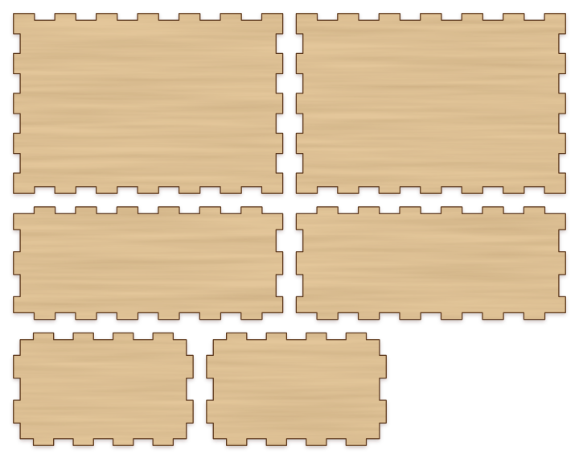
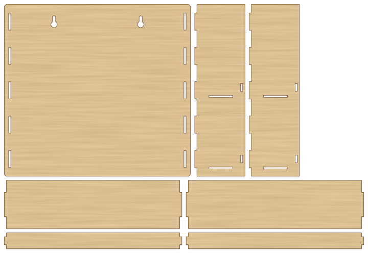
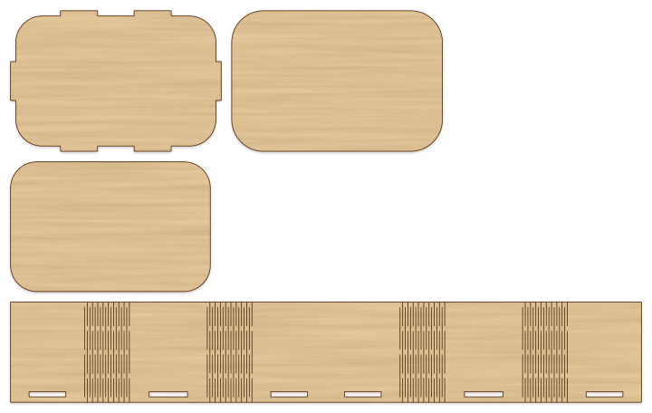
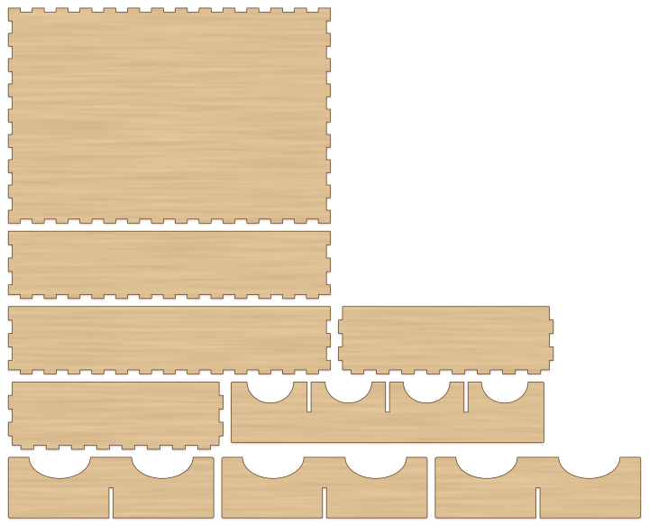
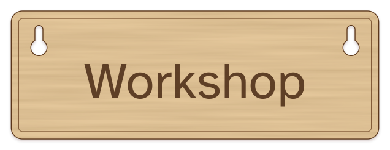
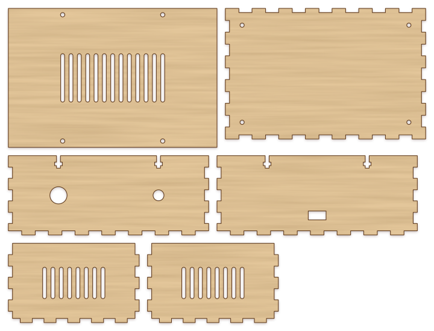
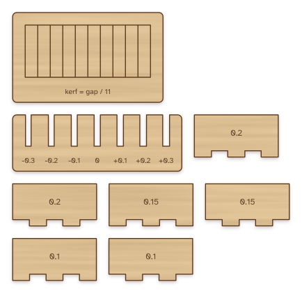

# Standard library

KerfScript comes with libraries for the parts most laser-cut designs need:
joints, hinges, dividers, hanging holes, boxes and test pieces. They are
built into every KerfScript renderer: the playground, the desktop app, the
command line and the JavaScript and WebAssembly libraries. A design that
uses them works everywhere without extra files.

```kerf
use <kerf/tabs>

part("shelf") tab_rect([200, 60], [false, true, false, true]);
```

`use` brings in a library's modules and functions. Its variables stay
inside it, and a module or function of your own with the same name is used
instead of the library's. Editors with the [language server](editors.md)
show each module's description when you hover over it.

| Library                            | Makes                                                          |
| ---------------------------------- | -------------------------------------------------------------- |
| [`kerf/box`](#boxes)               | Finger-jointed boxes and dividers that slide into them         |
| [`kerf/tabs`](#tabs-and-slots)     | Tabs on one panel and the slots in another that they go into   |
| [`kerf/hinge`](#living-hinges)     | Living hinges that bend flat sheet, and a box with round sides |
| [`kerf/dividers`](#dividers)       | Dividers that slot into each other like an egg crate           |
| [`kerf/hanging`](#hanging)         | Keyholes, holes and loops for hanging things on a wall         |
| [`kerf/enclosure`](#enclosures)    | Boxes with a screwed-on lid, cutouts for ports and vents       |
| [`kerf/calibration`](#calibration) | Test pieces that measure the kerf and how your sheet fits      |

Sizes are in millimetres. Joints use `$thickness`, the sheet thickness, so
set it to what you measure. Each section has an example in the gallery that
you can open in the playground.

## Boxes

`use <kerf/box>`



Finger-jointed boxes. Example: [box.kerf](../examples/box.kerf).

### `box(size, lid = false, finger)`

The panels of a box as parts `bottom`, `front`, `back`, `left`, `right` and,
with a lid, `lid`, placed for the assembled view.

| Parameter | Default                  | Meaning                                                |
| --------- | ------------------------ | ------------------------------------------------------ |
| `size`    |                          | Outside `[width, depth, height]`, lid included         |
| `lid`     | `false`                  | Add a lid, finger-jointed to the walls like the bottom |
| `finger`  | `max(3 * $thickness, 6)` | Finger width                                           |

### `divider(size, finger)`

A divider `[width, height]` with finger tabs on both sides, to slide into
rows of `finger_holes()` cut in two walls.

## Tabs and slots

`use <kerf/tabs>`



Tab and slot joints, for one panel standing on or through another. The
tabs are as deep as `$thickness`, so they finish flush with the far side.
Example: [spice-shelf.kerf](../examples/spice-shelf.kerf), a wall shelf
held together by tabs alone.

```kerf
use <kerf/tabs>

// A side with a slot for the shelf 40 mm up, and the shelf
part("side") difference() {
  rect([60, 120]);
  translate([0, 40]) slots(60);
}
part("shelf") tab_rect([150, 60], [false, true, false, true]);
```

### `tabs(length, count, width, depth)`

Tabs along x from 0 to `length`, hanging below y = 0: join them to the
bottom edge of a panel.

| Parameter | Default                         | Meaning                    |
| --------- | ------------------------------- | -------------------------- |
| `length`  |                                 | Length of the edge         |
| `count`   | one for every 50 mm, at least 1 | Number of tabs             |
| `width`   | half the space between tabs     | Width of each tab          |
| `depth`   | `$thickness`                    | How far the tabs stand out |

### `slots(length, count, width, clearance = 0.1)`

The slots that `tabs()` with the same `length`, `count` and `width` go
through, centred on y = 0. `clearance` is added to their width and to
`$thickness`; [cut a slot gauge](#calibration) to find the right
value for your sheet.

### `tab_rect(size, edges = true, count, width)`

A rectangle `[width, height]` with tabs outside it on some edges. `edges`
is `true` or `false` for all four, or `[bottom, right, top, left]`.

### `tab_positions(length, count)`

The centres of the tabs along an edge, for placing anything else that
lines up with them.

## Living hinges

`use <kerf/hinge>`



Living hinges: rows of cuts that let plywood bend. They work best in 3 mm
plywood or thinner. Example: [flex-box.kerf](../examples/flex-box.kerf),
and [hinge-card.kerf](../examples/hinge-card.kerf) for a simple fold.

```kerf
use <kerf/hinge>

// A strip that bends 90° around a 10 mm radius in the middle
flex_rect([200, 60], [100], width = bend_length(10));
```

### `bend_length(r, angle = 90)`

How long a living hinge must be to bend `angle` degrees around an inside
radius `r`: the length of the arc through the middle of the sheet.

### `flex_rect(size, bends, width, spacing = 1.5, bridge = 3, r = 0)`

A rectangle with a living hinge across its full height at each x in
`bends`.

| Parameter | Default                       | Meaning                                                     |
| --------- | ----------------------------- | ----------------------------------------------------------- |
| `size`    |                               | `[width, height]`                                           |
| `bends`   |                               | List of x positions, the middle of each hinge               |
| `width`   | `bend_length(3 * $thickness)` | Width of each hinge                                         |
| `spacing` | `1.5`                         | Distance between the rows of cuts; closer bends more easily |
| `bridge`  | `3`                           | Uncut length between cuts                                   |
| `r`       | `0`                           | Corner radius of the rectangle                              |

### `flex_box(size, r = 15, lid = true, clearance = 0.1, spacing = 1.5, bridge = 3)`

A box with round corners whose four sides are one strip, part `side`,
bent at the corners. The tabs of part `bottom` go through slots along the
strip. Part `lid` rests on top, and part `lid insert`, glued under it,
keeps it in place. `size` is the outside `[width, depth, height]`, lid
included, and `r` the outside corner radius, more than two thicknesses.
The strip is bent, so the parts are not placed in an assembled view.

### `flex_panel(size, r, sw, sd)`

The bottom of `flex_box()`: a rounded rectangle with tabs on its straight
edges, `sw` long on the front and back and `sd` on the sides.

## Dividers

`use <kerf/dividers>`



Dividers with slots halfway up, so a divider running one way and one
running the other slide into each other. Example:
[drawer-organizer.kerf](../examples/drawer-organizer.kerf), a box from
`kerf/box` with a grid of dividers inside.

```kerf
use <kerf/dividers>

// Four compartments across, two front to back, in a 200 × 120 space
grid_dividers([200, 120, 40], cols = 4, rows = 2);
```

### `grid_dividers(size, cols = 2, rows = 2, clearance = 0.15, gap = 0.5, scoops = false, at = [0, 0, 0])`

The dividers for a space `[width, depth, height]`, such as the inside of
a box, making `cols` compartments across and `rows` front to back. Parts
`long divider` run left to right and `cross divider` front to back.

| Parameter   | Default     | Meaning                                                               |
| ----------- | ----------- | --------------------------------------------------------------------- |
| `size`      |             | Inside `[width, depth, height]`; the dividers are this tall           |
| `cols`      | `2`         | Compartments across                                                   |
| `rows`      | `2`         | Compartments front to back                                            |
| `clearance` | `0.15`      | Added to the slot width                                               |
| `gap`       | `0.5`       | How far the dividers stop short of the walls                          |
| `scoops`    | `false`     | Dip the top edge over each compartment, to reach in                   |
| `at`        | `[0, 0, 0]` | Where the space's front left bottom corner is, for the assembled view |

### `slotted_divider(length, height, at = [], from = "top", clearance = 0.15, scoops = 0)`

One divider, with a slot half its height at each x in `at`: from the top,
or from the bottom with `from = "bottom"`. Two dividers that cross take
one of each. `scoops` is the number of finger dips in the top edge.

## Hanging

`use <kerf/hanging>`



Ways to hang a panel. Each module cuts its holes out of the shapes it is
given; given nothing, it makes the holes themselves, for a
`difference()` of your own. Example:
[wall-sign.kerf](../examples/wall-sign.kerf), with all three ways.

```kerf
use <kerf/hanging>

// Two keyholes 120 mm apart, 12 mm below the top edge
keyholes(120, at = [80, 48]) rect([160, 60], r = 5);
```

### `keyhole(at = [0, 0], head = 9, shank = 4.5, drop = 10)`

A keyhole for a screw: the head goes through the round hole, then the
panel drops `drop` mm so the screw rests at `at`, at the top of the slot.
`head` and `shank` are the widths of the hole and the slot: measure the
screw and add a little. `drop` must be at least `(head + shank) / 2`.

### `keyholes(spacing, at = [0, 0], head = 9, shank = 4.5, drop = 10)`

Two keyholes `spacing` apart, centred on `at`, for a panel that hangs
level.

### `hanging_hole(at = [0, 0], d = 5, spacing = 0)`

A round hole for a nail, a hook or a cord, or two `spacing` apart.

### `hanging_loop(at = [0, 0], d = 4, wall = 3)`

A ring `wall` wide around a hole of diameter `d`, joined to the shapes it
is given. Put it over the edge of an ornament or a tag: the hole stays open
where the ring overlaps the shape. Overlap the ring with the shape, or the
loop comes out as a separate piece.

## Enclosures

`use <kerf/enclosure>`



A box whose lid comes off again, for electronics. The walls and the bottom
are finger jointed. The lid overhangs the walls a little and is held by
screws that go down into the walls' top edges, each into a nut that sits
in a T-slot. Example: [project-enclosure.kerf](../examples/project-enclosure.kerf).

```kerf
use <kerf/enclosure>

enclosure([150, 100, 60], cutouts = [
  ["front", [36, 28], 8],              // a round hole for a jack
  ["back", [72, 15], [13, 6.5]],      // a rectangle for a USB port
  ["lid", [75, 50], [70, 30], "vents"],
]);
```

### `enclosure(size, screw = 3, screw_length = 12, nut, lip, cutouts = [], finger)`

Parts `bottom`, `lid`, `front`, `back`, `left` and `right`, placed for the
assembled view. Two screws go into the front wall and two into the back,
and one more each for every 80 mm of width.

| Parameter      | Default                      | Meaning                                        |
| -------------- | ---------------------------- | ---------------------------------------------- |
| `size`         |                              | Outside `[width, depth, height]`, lid included |
| `screw`        | `3`                          | Screw diameter: 3 for M3                       |
| `screw_length` | `12`                         | Screw length under the head                    |
| `nut`          | `[screw * 1.9, screw * 0.9]` | `[width, height]` of the slot for the nut      |
| `lip`          | `screw`                      | How far the lid overhangs the walls            |
| `cutouts`      | `[]`                         | Holes in the panels, see below                 |
| `finger`       | `max(3 * $thickness, 6)`     | Finger width                                   |

The walls stand `lip` in from the edge of the lid, so a design for an
`[150, 100, 60]` enclosure with M3 screws has walls 144 × 94 mm.

### `enclosure_cutouts(side, cutouts)`

The holes in `cutouts` for one panel; `enclosure()` cuts them. Each is
`[side, [x, y], size]`:

- `side` is `"front"`, `"back"`, `"left"`, `"right"`, `"lid"` or `"bottom"`.
- `[x, y]` is the middle of the hole on the panel as it is drawn, from its
  bottom left corner. On the front and back x runs left to right as seen
  from the front; on the sides it runs from front to back. y runs up from
  the bottom of the wall.
- A number `size` is a round hole of that diameter, `[width, height]` a
  rectangle. Add `"vents"` after a rectangle to fill it with vents.

### `vents(size, slot = 3, pitch = 6)`

Ventilation slots across `[width, height]`, centred on the origin: upright
slots `slot` wide with round ends, `pitch` apart.

## Calibration

`use <kerf/calibration>`



Test pieces to cut once for every new material, before a design that has
to fit. Their labels are text, so they need a font, as
[`text()`](../LANGUAGE.md#shapes) does; `labels = false` leaves them off.
Example: [calibration-set.kerf](../examples/calibration-set.kerf); the
[Kerf](kerf.md) guide explains what to do with the results.

```kerf
use <kerf/calibration>

$thickness = 3;
part("kerf gauge") kerf_gauge();
part("slot gauge") slot_gauge();
joint_test([0.1, 0.15, 0.2]);
```

### `kerf_gauge(strips = 10, size = [60, 25], labels = true)`

A frame with `strips` strips inside, all separated by single cuts.
Single cut lines are not moved by kerf compensation, so each takes away
one kerf. Push the strips to one side and measure the gap they leave: the
kerf is the gap divided by `strips + 1`. `size` is the window the strips
fill.

### `slot_gauge(steps = 7, step = 0.1, depth = 15, labels = true)`

A comb of `steps` slots, from narrower than `$thickness` to wider, `step`
apart, each labelled with the difference. Try a scrap of the same sheet in
each: the one that fits as you want is the clearance for `slots()` and
`grid_dividers()`.

### `joint_test(kerfs = [0.1, 0.15, 0.2], size = [40, 20], finger, labels = true)`

A pair of finger-jointed pieces for each kerf in `kerfs`, parts
`joint <kerf> out` and `joint <kerf> in`, each cut with that kerf
compensation. The pair that holds together without glue or forcing has
the kerf to set for this sheet.
